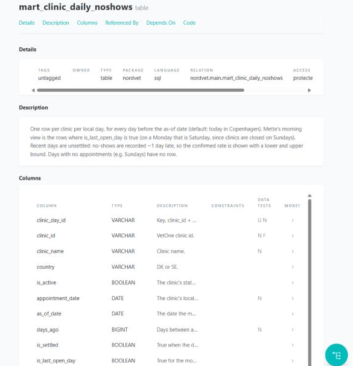

# Nordvet no-show pipeline


## The problem

## Quickstart
### Prerequisites:
- Windows
- git 
-  **Python 3.13**. dbt doesn't install on Python 3.15 yet (D-python)

####  you don't hav.13: `py install 3.13` with the Python install manager, or the installer from python.org. You also need VetOne API credentials from Nordvet IT.

### Setup 

You will only have to do this once, in PowerShell from the folder you want the project in.

```bash
git clone https://github.com/anjkrish2608/VetOneInsights.git
```

```bash
cd VetOneInsights
```

```bash
py -3.13 -m venv .venv
```

```bash
.venv\Scripts\python -m pip install -r requirements.txt
```

```bash
copy .env.example .env
```

Then open `.env` and fill in:
- `VETONE_BASE_URL`
- `VETONE_CLIENT_ID` 
- `VETONE_CLIENT_SECRET`

`.env` is gitignored; never commit it.

### Run (one command, from the repo root):

```bash
.venv\Scripts\python run_pipeline.py
```

- **Warnings to look for** in the log: `VetOne data looks stale`, `Last page was full …`, or
  `Backfill has no deleted appointments`. Each one means VetOne may have changed how its API
  behaves (D-api-change).
- Safe to re-run at any time: nothing is duplicated or lost.


## How it works
Every morning, this pipeline pulls appointments for Nordvet's clinics from VetOne and showshow each clinic did on the last open day: confirmed no-shows, appointments still awaiting a
 status, and the vet time lost. It also ranks clinics by no-show rate over recent days whosenumbers have settled. It answers Mette's "how did each clinic do yesterday?" and Karin's
 "where are we losing money?" (in vet hours, since VetOne has no prices). It is a first slicit runs on a laptop today, and the target set-up in Nordvet's Azure is described below.

 
```
VetOne API ──► Python ingestion ──► raw tables ─────► dbt staging ─────► dbt marts ─────► Power BI
               login, paging,       append-only:       latest version    one row per          FINDINGS.md
               retries,             every version      per appointment,  clinic per day,
               updated_since        ever fetched       deleted removed   and a clinic ranking
```

The same flow as dbt draws it from the code (`dbt docs`, see below):


- **First run** (empty database): a backfill from 1 Sep 2026 of about 50,000 appointments,
  taking about 2 minutes. Most of that is waiting when VetOne asks it to slow down.
- **Every run after that:** only appointments changed since the last run. A few seconds.
- Then dbt checks that VetOne's data is fresh (`dbt source freshness`, a warning only) and
  `dbt build` builds the 4 models and runs all 37 data tests. The run ends with
  `Pipeline run … finished`, or exits with code 1 and a clear `FAILED` message.

**See the output:**

- **The two report tables** live in `data/nordvet.duckdb`: `mart_clinic_daily_noshows` and
  `mart_clinic_noshow_ranking`. The quickest way to look at them is `dbt show`, from the repo
  root after a run. It shows 5 rows unless you add `--limit`, and cuts off wide columns, so
  pick the columns you need. `{{ ref('…') }}` is dbt's way of naming a model.

  Mette's morning view (last open day, most no-shows first, D-morning-sample):

  ```bash
  .venv\Scripts\dbt show --project-dir nordvet_dbt --profiles-dir nordvet_dbt --limit 50 --inline "select clinic_name, appointments, no_shows, awaiting_status, round(100 * no_show_rate, 1) as rate_pct from {{ ref('mart_clinic_daily_noshows') }} where is_last_open_day order by no_shows desc, awaiting_status desc"
  ```

  The ranking (worst no-show rate first over the recent settled days, D-ranking-window):

  ```bash
  .venv\Scripts\dbt show --project-dir nordvet_dbt --profiles-dir nordvet_dbt --limit 50 --inline "select rank_recent, clinic_name, round(100 * no_show_rate_recent, 1) as rate_pct, no_shows_recent, lost_vet_hours_recent from {{ ref('mart_clinic_noshow_ranking') }} order by rank_recent"
  ```

  Where the most vet time is lost (for Karin: total hours, so busy clinics rank higher, D-money):

  ```bash
  .venv\Scripts\dbt show --project-dir nordvet_dbt --profiles-dir nordvet_dbt --limit 50 --inline "select clinic_name, lost_vet_hours_recent, no_shows_recent, round(100 * no_show_rate_recent, 1) as rate_pct, rank_recent from {{ ref('mart_clinic_noshow_ranking') }} order by lost_vet_hours_recent desc"
  ```

  Any number in FINDINGS.md, through its analysis file (see its appendix):

  ```bash
  .venv\Scripts\dbt show --project-dir nordvet_dbt --profiles-dir nordvet_dbt --select findings_01_morning_total
  ```

  For every column at full width, open the file in a DuckDB client (e.g. DBeaver), or use
  Python: `.venv\Scripts\python -X utf8 -c "import duckdb; duckdb.connect('data/nordvet.duckdb', read_only=True).sql('select * from mart_clinic_noshow_ranking order by rank_recent').show()"`
  (`-X utf8` lets Windows print the table borders and Danish/Swedish letters.)
- **Browsable documentation and lineage graph** (after a run has finished, since DuckDB allows
  one writer at a time):

  ```bash
  .venv\Scripts\dbt docs generate --project-dir nordvet_dbt --profiles-dir nordvet_dbt
  ```

  ```bash
  .venv\Scripts\dbt docs serve --project-dir nordvet_dbt --profiles-dir nordvet_dbt
  ```

  This opens a page in your browser showing every model, column and test with its
  description, and the lineage from the raw tables to the marts. Stop it with Ctrl+C.

  
- **Re-run a past morning:** rebuild the marts as of any date (as in FINDINGS.md):

  ```bash
  .venv\Scripts\dbt build --project-dir nordvet_dbt --profiles-dir nordvet_dbt --vars "{as_of_date: '2026-11-09'}"
  ```

**Start again from scratch:** delete `data/nordvet.duckdb` and run again.

---

###  2. Data model

| Layer | Model | One row per | What it does |
|---|---|---|---|
| raw | `raw_appointments` | appointment, per run that fetched it | Exactly what VetOne sent, append-only, plus `_run_id` and `_loaded_at`. `patient_ref` and `vet_id` are never stored. |
| raw | `raw_clinics` | clinic, per run | A full snapshot of the clinic list on every run. |
| staging | `stg_vetone__appointments` | appointment | The latest version of each appointment, with deleted ones removed and timestamps typed. |
| staging | `stg_vetone__clinics` | clinic | The latest snapshot (39 clinics, 38 active). |
| mart | `mart_clinic_daily_noshows` | clinic per day | Counts, confirmed rate with lower/upper bounds, awaiting status, lost vet minutes, and `last_loaded_at` (when data last arrived). Mette's view: `is_last_open_day`. |
| mart | `mart_clinic_noshow_ranking` | active clinic | Rate over the newest 28 settled days (ranked) and over all history (baseline), with the gap to the network rate. |

Python only does the API part ([ingestion/](ingestion/)); everything after the raw tables is
SQL in dbt ([nordvet_dbt/models/](nordvet_dbt/models/)). Data quality checks are dbt tests:
unique and not-null keys, allowed status values, appointments → clinics, plus three SQL tests
([nordvet_dbt/tests/](nordvet_dbt/tests/)): rates between 0 and 1, lower ≤ rate ≤ upper, and
the daily mart reconciles to staging.

---

## Repo structure

## Assumptions

**The metric** (fixed with Nordvet's brief):
- No-show rate = no-shows ÷ (completed + no-shows). Cancelled appointments are left out (D-formula).
- "Yesterday" = the last day any clinic was open, so Saturday on a Monday (D-last-open-day).
- No-shows are recorded about a day late, so yesterday is shown as confirmed no-shows plus a
  separate "awaiting status" count, with a lower and upper rate (D-metric).
- The last 3 days are unsettled and left out of the ranking (D-settled).
- Money is measured as booked vet minutes lost, because VetOne has no prices (D-money).
  "Full-time vets" assumes a 37-hour week (D-fte).

**The data:**
- VetOne sends each appointment's start in the clinic's local time; that date is the "day" (D-timestamps).
- `duration_minutes` is the booked length, fixed per service.
- Clinics are closed on Sundays. VetOne lists 39 clinics (the brief says 38); Ystad is
  inactive and left out of the ranking (D-inactive).
- A cancellation recorded after the appointment started is still treated as a cancellation,
  not a no-show. This is a question for Nordvet (D-late-cancellations).

**The API** (found by testing; evidence in [docs/vetone_api_notes.md](docs/vetone_api_notes.md)):
- Deleted appointments are hidden unless `include_deleted=true` is sent, and only the exact
  value `true` works (D-deleted).
- `updated_since` returns every appointment changed since a time, including old ones whose
  status changed late. The pipeline uses the newest `updated_at` it already has (D-incremental).
- `limit` is silently capped at 500; some wrong parameters return 200 with wrong data, so the
  code checks its own inputs (D-backfill, D-validate).
- Tokens last 60 minutes; VetOne returns temporary 500s and rate limits (429) with
  `Retry-After`, and the pipeline handles each (D-errors).

---

## Left out on purpose

| Left out | Why |
|---|---|
| Real-time | Mette needs yesterday, each morning. No-shows arrive a day late anyway, so real-time would show wrong numbers faster and cost more (D-batch). |
| Building anything in Azure | The brief asks for a local first slice; the Azure set-up is described below. |
| A Power BI report | FINDINGS.md covers Mette's question in this slice; the marts are ready for Power BI. |
| Docker, Airflow and other orchestrators | One daily job; a scheduled `python run_pipeline.py` is enough (D-entry). |
| Python unit tests (pytest) | Data checks in dbt come first; unit tests for the API client are a next step (D-tests). |
| Vet- and patient-level analysis | Not needed for a clinic view; `vet_id` and `patient_ref` aren't stored (D-fields). |
| Kroner | VetOne has no prices; lost time is in vet hours until Nordvet gives a rate per hour (D-money). |
| Counting late cancellations as no-shows | Changes the agreed metric; raised with Nordvet instead (D-late-cancellations). |
| A mart for service and weekday | Those two findings are queried by hand in FINDINGS.md for now (D-findings-staging). |
| Incremental dbt models | A full rebuild takes about a second at this size (D-materialization). |
| Alerting on spikes | A next step once Mette has used the daily view. |
| A weekly cross-check of recent data against VetOne | The guards in D-api-change catch most API changes; a full re-pull comparison is a next step. |
| dbt v2 | dbt Core v1 has the adapter support and documentation Emil's team will need (D-dbt-v1). |
| Hosting the dbt docs | They run locally; a static site in Azure is a small next step. |

Known gap: the API's response to an expired token was never observed; the pipeline fetches a
new token on any 401, which is tested with an invalid token.

---

## Where this runs for Nordvet (Azure)

Nordvet already uses Microsoft 365 and Azure, so the pipeline moves there with as little new
as possible. The Python and dbt code stays the same apart from the database it writes to.

```
 06:00  Azure Container Apps Job ──► VetOne API
        runs: python run_pipeline.py
        secrets from Key Vault
              │
              ▼
        Azure SQL Database  (raw ─► staging ─► marts, built by dbt)
              │
              ▼
 07:00  Power BI report on the marts ──► Mette: subscription email or Teams post
                                         Karin: lost vet hours by clinic
        Failed run ──► Azure Monitor alert email to Emil's team
```


**Components:**
- **Azure Container Apps Job** runs the same command on a daily schedule. A failed run exits
  with code 1, so Azure marks it failed and Azure Monitor emails the team.
- **Azure Key Vault** holds the VetOne credentials. They reach the job as environment
  variables, which the code already reads, so no code changes.
- **Azure SQL Database** replaces the DuckDB file (D3, D-azure). Emil's team already knows
  SQL Server tools, and Power BI connects to it natively. The dbt models move with the
  `dbt-sqlserver` adapter; a few DuckDB-specific bits need rewriting in T-SQL (`qualify` in
  the dedupe, `timezone()`, `strftime`, `datediff`), and the raw loader switches from DuckDB
  to an Azure SQL connection.
- **Power BI** reads the two marts, refreshed after the job. Mette gets the morning view by
  email subscription or in Teams (e.g. via Power Automate), so there's nothing extra to open.
  To check with Nordvet first: subscription emails and sharing need Power BI Pro (or Premium
  Per User / capacity), so this depends on what their licence includes. Not verified yet.

**Rough monthly cost** (list prices checked 9 Nov 2026, USD; confirm in the Azure pricing
calculator for Nordvet's region):

| Item | Cost |
|---|---|
| Container Apps Job | **$0**: a 2-minute daily run uses about 1% of the free monthly grant (180,000 vCPU-seconds) |
| Azure SQL Database, Basic (5 DTU, 2 GB) | **about $5** (up to about $20 in some regions); the data is tens of MB |
| Key Vault, Azure Monitor | **a few dollars at most** |
| **Infrastructure total** | **about $5–25 a month** |
| Power BI Pro | $14 per user per month; included in Microsoft 365 E5, so Nordvet may already have it |

**Against Karin's test** ("the platform must not cost more than the no-shows"): no-shows cost
about 560 vet hours a month. For the infrastructure to cost as much, a vet hour would have to
be worth a few cents.

**Who runs it:**
- **Emil's team** owns it after handover. They change the SQL models (dbt is SQL plus a little
  YAML), watch the failure alert and re-run a failed day with the same command.
- **If VetOne changes its API**, the run either stops with a message naming what changed (a
  missing field or key, a new status, an error code) or logs one of the warnings above; it
  doesn't load quietly wrong numbers. After a failed run, Mette's view keeps the last good
  numbers, and `last_loaded_at` shows how old they are (D-api-change).
- **Nordvet IT** owns the VetOne credentials and rotates them in Key Vault.
- **Heyra** hands over the repo, this README and DECISIONS.md, and a walkthrough of the dbt docs.

---

## What I'd do next

---

## More detail 
  - **What we found:** [FINDINGS.md](FINDINGS.md)
  - **Why it's built this way:** [DECISION S.md](DECISIONS.md) (decisions are referred to as D-… below)
  - **What the VetOne API actually does:** [docs/vetone_api_notes.md](docs/vetone_api_notes.md)


